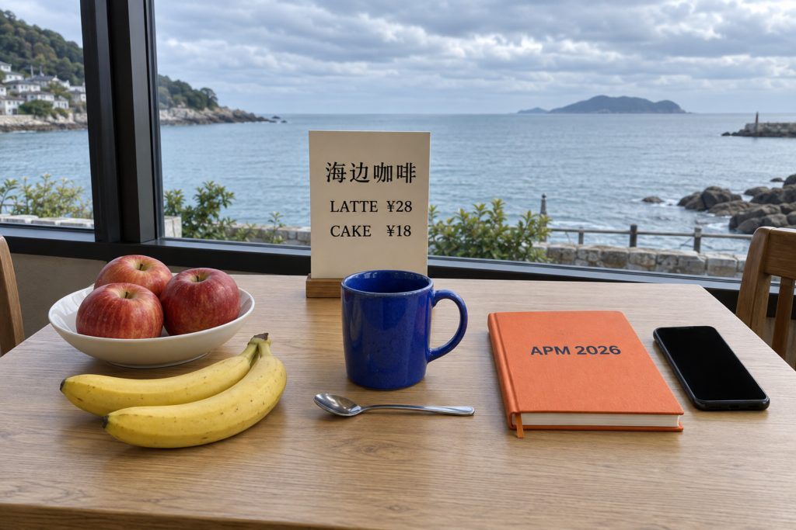

# Qwen3.6 MoE 在 xspark 上的并发实测

2026-11-11，20:40–20:54 完成测试，20:55 前完成收尾核对（北京时间）。机器：xspark，`192.168.2.10`。

本报告记录上线前的配置对照。同日稍后已将现有 Qwen 服务和 App 更新为默认 8 路，见 [0.1.0 验收记录](../../roadmap-0.1.0-validation.md)。以下“现有 API”指本轮基准测量时的单路配置。

**本次验证了 8 路短图片标注并发。** 允许批处理后，总输出吞吐从单路的 **67.80 token/s** 提高到 **249.21 token/s**，约 **3.68 倍**；8 张图从串行的约 82 秒缩短到约 22 秒。64 次正式请求全部成功，另有两次不计入统计的预热请求。

现有 new-api 后端仍设置为 `--max-num-seqs 1`。它能接收多个请求，但模型一次只处理一个：8 个同时到达的请求需要约 80 秒才全部完成。本次通过独立临时实例测试批处理，未把线上配置改为 8 路。

## 测试条件

| 项目 | 设置 |
|---|---|
| 硬件 | NVIDIA GB10；128 GB 统一内存，系统可见约 121.6 GiB |
| 模型 | `nvidia/Qwen3.6-35B-A3B-NVFP4`，API ID `qwen3.6-35b-a3b` |
| 部署清单中的模型版本 | `1355db6a052410cfd62085d94b58866fd0f2c3c5`；复用已有权重，本轮未重新下载或逐片重算权重哈希 |
| 运行时 | vLLM 0.28.0、PyTorch 2.13.0、Transformers 5.16.1、FlashInfer 0.6.16.post3 |
| 共同参数 | 16,384 上下文；2 GiB KV 缓存；`max-num-batched-tokens=2048`；Marlin MoE；FlashInfer attention；关闭思考 |
| 解码 | `temperature=0`、`seed=23`、`max_tokens=1536`；JSON Schema 约束 |
| 图片与任务 | 沿用此前基准的 1024×683 合成咖啡馆图片，以及 `photo-annotation-zh-v7` 提示词和 Schema |
| 现有 API | 本机 new-api `3000` → 已有 Qwen `8096`；`max-num-seqs=1`，CUDA Graph 批次 `[1]` |
| 临时实例 | 直接请求本机 `8098`；`max-num-seqs=8`，CUDA Graph 批次 `[1,2,4,8]`；其余模型参数保持一致 |



每个实例先完成一次完整标注预热，再依次测试客户端并发 1、2、4、8。每档固定 8 次请求；前 C 次同时发起，有请求完成就补下一个，直到 8 次全部完成。因此 8 路档位是一波突发请求，不能当作长时间稳定负载测试。

图片、提示词和 Schema 的哈希与[原基准](../xspark-vlm-2026-09-23/README.md)一致。每个请求在提示词开头增加要求忽略的随机编号，并设置独立 `cache_salt` 和图片 UUID；视觉处理缓存为 0。各档服务端前缀缓存命中增量均为 0，避免重复同一图片靠缓存得到虚高结果。随机编号使输入略有变化：每次输入 930–935 token，输出 630–728 token，因此同时报告 token 吞吐与请求吞吐。

请求使用流式返回测首个正文片段。完整耗时从客户端发起 HTTP 请求计到流结束；成功必须满足 HTTP 200、完整 JSON 通过 Schema、`finish_reason=stop`，且收到流结束标记。没有重试，单请求期限为 180 秒。

## 现有 API：并发请求进入队列

| 客户端并发 | 8 次全部完成 | 单次耗时中位数 | 单次最大耗时 | 首字中位数 | 总输出 token/s | 请求/分钟 | 成功 |
|---:|---:|---:|---:|---:|---:|---:|---:|
| 1 | 81.21 s | 10.29 s | 10.50 s | 0.323 s | 68.60 | 5.91 | 8/8 |
| 2 | 80.74 s | 19.96 s | 20.75 s | 10.290 s | 68.86 | 5.95 | 8/8 |
| 4 | 76.75 s | 37.81 s | 39.00 s | 28.468 s | 68.75 | 6.25 | 8/8 |
| 8 | 79.81 s | 45.64 s | 79.79 s | 35.466 s | 68.52 | 6.01 | 8/8 |

从 1 路到 8 路，总吞吐始终约 69 token/s。8 路时，最后一个请求约等到第 70 秒才收到正文，第 80 秒才完整结束。这个配置下，客户端增加并发主要增加排队。

## 临时实例：允许 8 个请求同时推理

| 客户端并发 | 8 次全部完成 | 单次耗时中位数 | 单次最大耗时 | 首字中位数 | 总输出 token/s | 请求/分钟 | 成功 |
|---:|---:|---:|---:|---:|---:|---:|---:|
| 1 | 81.52 s | 10.22 s | 10.68 s | 0.301 s | 67.80 | 5.89 | 8/8 |
| 2 | 54.46 s | 13.55 s | 14.30 s | 0.331 s | 100.25 | 8.81 | 8/8 |
| 4 | 34.06 s | 16.26 s | 17.94 s | 0.534 s | 162.40 | 14.09 | 8/8 |
| 8 | 21.97 s | 21.22 s | 21.96 s | 1.690 s | 249.21 | 21.84 | 8/8 |

8 路的 token 吞吐是同一临时实例单路的 **3.68 倍**。代价是每个请求的完整耗时从约 10.22 秒增加到 21.22 秒，但 8 张图的整体完成时间大幅缩短。4 路处于两者之间：约 162 token/s，单次中位数约 16.26 秒。

总输出吞吐 = 本档全部输出 token ÷ 本档从启动请求到全部完成的墙钟时间，包含预填充和补充请求的开销，不是把各请求的瞬时解码速度相加。请求/分钟也是由这 8 次的墙钟时间折算，未做一分钟以上的持续满载测试。两组分别经过网关和直接访问模型；**3.68 倍来自临时实例内部对比**，不把两条路径的差异全部归因于调度参数。

## 服务端指标核对

每 0.5 秒采样一次 vLLM 指标，档位之间留出 6 秒等待指标更新。每档服务端成功计数恰好增加 8，与客户端记录一致；所有档位的抢占次数增量为 0。Qwen 和 Gemma 的成功计数未显示额外请求混入测试窗口。

| 配置 | 客户端并发 | 观测到的最大运行数 | 最大等待数 | 服务端平均排队 | 输出 token 范围 | KV 占用峰值 |
|---|---:|---:|---:|---:|---:|---:|
| 现有 API | 1 | 1 | 0 | 0.000 s | 644–722 | 8.2% |
| 现有 API | 2 | 1 | 1 | 8.589 s | 657–726 | 5.1% |
| 现有 API | 4 | 1 | 3 | 21.215 s | 630–711 | 8.2% |
| 现有 API | 8 | 1 | 7 | 35.086 s | 654–722 | 5.1% |
| 临时 8 路实例 | 1 | 1 | 0 | 0.000 s | 648–728 | 5.1% |
| 临时 8 路实例 | 2 | 2 | 0 | 0.000 s | 633–728 | 10.2% |
| 临时 8 路实例 | 4 | 4 | 1 | 0.056 s | 636–727 | 20.4% |
| 临时 8 路实例 | 8 | 8 | 5 | 0.524 s | 631–719 | 40.8% |

临时实例的 8 路首字中位数为 1.69 秒。请求同时到达时仍要进行视觉处理和分批预填充，所以会短暂等待；指标确认后续确实有 8 个请求同时运行。正式请求期间未记录新的推理内核 JIT 编译警告；启动和预热中的编译不计入表格。

测试期间原有 Qwen、Gemma 和 IndexTTS 继续驻留。临时实例各正式档位的主机可用内存最低为 **30.47 GiB**，未触发 12 GiB 保护阈值。GB10 使用统一内存，这里的值来自主机 `MemAvailable`，不是把 `nvidia-smi` 的进程用量当作整机内存。

## 对 APM 的含义

现有后端的 `max-num-seqs=1` 需要调整，才能使用这里测到的批处理收益。该参数限制单次调度可处理的序列数，说明见 [vLLM 官方参数文档](https://docs.vllm.ai/en/latest/configuration/engine_args/#--max-num-seqs)。

APM 当前在 [`MainActivity.kt`](../../../android/app/src/main/java/com/jinof/apm/MainActivity.kt) 中循环逐张调用 `client.annotate`，还没有并发标注。只调整服务器，不会自动让单个 App 的照片批次变快。后续若要落地，可以从 **4 个在途请求**开始兼顾响应耗时；明确以整批完成速度为目标时，再使用本轮验证的 **8 路**。这是根据本图短请求的实测作出的建议，本次没有修改 App 或线上配置。

## 适用范围

- 只测试了一张合成图；64 次重复用于测并发和协议有效性，不代表 64 个独立视觉样本。Schema 全通过不等于视觉内容全正确，本轮未重做视觉准确率评分。
- 每档只有 8 次，报告中位数和最大值，不据此声称 p95、p99 或长期稳定性，也未搜索最高并发上限。
- 实际输入约 930 token、输出约 700 token。2 GiB KV 缓存启动日志标注容量为 73,728 token、16,384 token 满长请求约 4.50 倍容量；**这次短请求的 8 路成功，不表示能同时承载 8 个满 16K 请求**。
- 请求从 xspark 回环地址发起，没有覆盖手机图片处理、Wi-Fi、外网或后台恢复，也没有覆盖长视频、多图和其他模型同时进行推理的竞争场景。
- [`ExternalApiClient.kt`](../../../android/app/src/main/java/com/jinof/apm/ExternalApiClient.kt) 当前使用非流式请求并等待完整正文。首字时间可用于定位排队，App 用户实际仍需等待完整标注。

## 收尾与复核资料

临时实例已停止，8098 端口已关闭；临时测试令牌已删除，本次创建的凭据缓存也已移除。现有 Qwen、Gemma、IndexTTS 的主进程号和重启计数前后一致。Qwen 服务配置与密钥文件哈希、new-api 渠道配置和既有令牌权限哈希均一致。

Qwen、Gemma、new-api 健康检查通过。收尾脚本最初误用 `/health` 检查 IndexTTS，得到 404；读取其 OpenAPI 后改用实际的 `/healthz`，返回 HTTP 200、`status=ready`，已单独保留纠正记录。未重启或重新配置任何原有服务，原本未运行的 H3 和 Qwen3.8 保持原状态。

脚本、逐次响应、原始指标、启动日志和前后状态保留在 xspark：

```text
/home/jinof/benchmarks/apm-qwen-concurrency-20261111-0vbb88n4/
```

本机证据副本：

```text
/private/tmp/apm-qwen-concurrency-20261111-0vbb88n4/evidence/
```

复测应新建目录和临时单元名，避免覆盖本轮结果；沿用同一图片、提示词、Schema 和上述采样参数。测试脚本 SHA-256：`91f39a89621f1d0b213ebc13a9ba8d017a47e9b034c0c7859e8ef4f1ec7ad0e8`。

| 输入 | SHA-256 |
|---|---|
| 图片 | `6e04b7e5f1a60367d5e12ec4819a3179fb7c1ebc7fa23d0e6619359c6f8966f9` |
| 原始提示词 | `0acd5a7bb86bfc65601f4af272036d545309371bf1144de54561261f6e7e139f` |
| Schema | `e43ef1c52628aa224e956649f0f919cb70de85de13c2480838d856073a24ea63` |

## 逐次完整耗时

下面按客户端请求编号 0–7 排列，单位为秒；并发时编号不代表完成顺序。

| 配置 | 并发 | 0 | 1 | 2 | 3 | 4 | 5 | 6 | 7 |
|---|---:|---:|---:|---:|---:|---:|---:|---:|---:|
| 现有 API | 1 | 10.50 | 10.37 | 10.36 | 9.40 | 10.21 | 10.14 | 9.77 | 10.38 |
| 现有 API | 2 | 20.75 | 10.50 | 19.89 | 19.44 | 20.02 | 20.46 | 19.80 | 20.06 |
| 现有 API | 4 | 28.44 | 19.26 | 37.74 | 9.81 | 37.90 | 37.88 | 37.97 | 39.00 |
| 现有 API | 8 | 60.41 | 50.83 | 20.39 | 79.79 | 70.08 | 29.92 | 10.39 | 40.44 |
| 临时 8 路实例 | 1 | 10.68 | 9.97 | 10.28 | 10.16 | 9.57 | 9.88 | 10.45 | 10.41 |
| 临时 8 路实例 | 2 | 14.06 | 12.46 | 14.30 | 14.06 | 12.59 | 13.86 | 13.24 | 12.42 |
| 临时 8 路实例 | 4 | 15.18 | 17.94 | 17.66 | 17.23 | 15.34 | 16.13 | 16.39 | 15.83 |
| 临时 8 路实例 | 8 | 21.20 | 20.10 | 21.89 | 21.17 | 21.89 | 21.96 | 19.74 | 21.25 |
