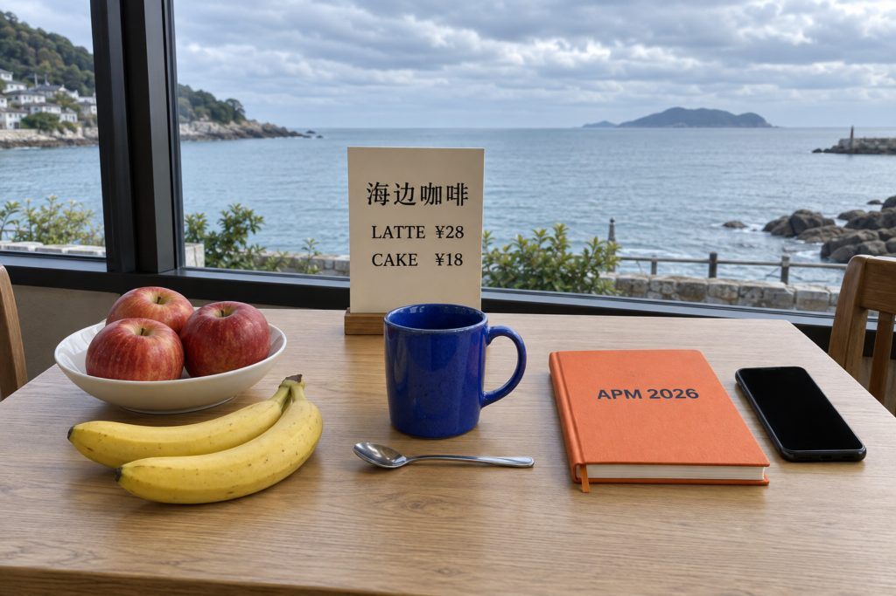
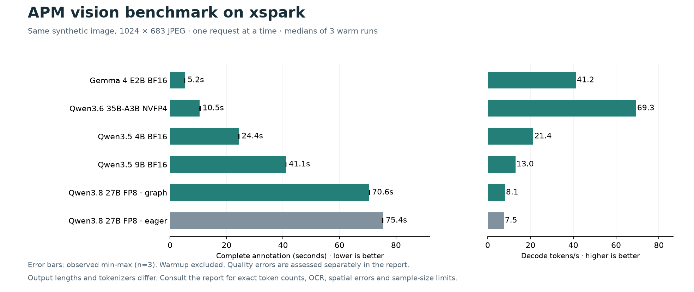

# xspark 多模态模型速度与效果实测

日期：2026-09-23。测试地点：用户的 xspark（`192.168.2.10`）。测试了 **5 款模型、6 种运行配置，共 30 次请求**；其中 18 次用于稳定速度统计，其余为预热与视觉问答。

## 建议

**APM 提速优先考虑 Qwen3.6-35B-A3B NVFP4。** 本次完整标注从当前 Qwen3.8-27B FP8 的 **75.39 秒降到 10.52 秒**，约快 **7.17 倍**；23 项视觉问答全部正确，主要物体计数和 OCR 也通过。不过完整标注仍有香蕉位置、手机朝向等错误，不能把它视为与 27B 等质的替换。

**需要更克制的标注时，保留 27B 作为质量参照。** 它在这张图上未发现明显内容错误。单独启用 CUDA Graph 后降至 **70.56 秒**，只缩短 **6.4%**，不能解决一分钟级的等待。

Gemma 4 E2B 的 **5.23 秒**是最快的完整响应，但内容遗漏和识别错误明显，暂不推荐用于当前 APM 标注。Qwen3.5 4B、9B 也出现了无依据人物标注；这张图上，9B 没有表现出足以抵消额外延迟的优势。

这些建议只适用于本次配置与样本。效果样本只有一张合成图，正式替换前宜用自己的不同场景照片复核；本轮没有读取私人图库，也没有修改线上模型或 APM 推荐项。

## 测试图与方法



原图由内置 imagegen 生成，检查实际图片后固定答案：三个红苹果在白碗中，两根香蕉在桌上，蓝杯把手朝右，银色勺子在杯前，橙色封面写着 `APM 2026`，黑色手机屏幕朝上但未亮，菜单为 `海边咖啡 / LATTE ¥28 / CAKE ¥18`，窗外是白天海景和多云天空，没有可确认的人物或动物。

- 所有模型收到同一份 **1024×683、JPEG 质量 82** 的图片，符合 APM 主请求的尺寸策略。不同模型仍使用各自原生视觉预处理。
- 完整标注使用与 Android 完全相同的 `photo-annotation-zh-v7` 提示词，并重建同一 JSON Schema 的字段和限制。
- 固定单并发、16K 上下文、2 GiB KV 缓存、temperature=0、seed=23、关闭思考。每组一次预热后测三次，报告中位数和实际范围。
- 每次使用新的缓存盐和图片 UUID，避免重复图片缓存虚增速度。各临时模型依次运行；生产 27B 与 IndexTTS 保持驻留，未向 IndexTTS 发测试任务。
- 测量从 xspark 本机直接请求模型接口，使用流式返回测首字；总时间包含完整 JSON 的生成。**不包含手机缩略图处理、无线网络和 new-api 转发时间**，也不是多并发吞吐测试。

[完整协议](protocol.md) · [生成提示词](image-prompt.txt) · [原图](assets/cafe-original.png) · [输入哈希](input-manifest.json) · [评分答案](ground-truth.json)

## 速度

除第一行当前生产配置外，均启用单并发解码 CUDA Graph；未启用 torch.compile、MTP 或其他投机解码。MoE 使用 Marlin MoE 和 FlashInfer attention。数值是本次配置实测，不代表各模型的速度上限。

| 模型与配置 | 完整标注中位数 | 三次范围 | 首字中位数 | 解码速度 | 输出 token |
|---|---:|---:|---:|---:|---:|
| Qwen3.8-27B FP8，当前 eager | 75.39 s | 75.18–75.40 s | 0.877 s | 7.53 token/s | 561 |
| Qwen3.8-27B FP8，Graph | 70.56 s | 70.53–70.61 s | 0.873 s | 8.05 token/s | 561 |
| Qwen3.5-4B BF16，Graph | 24.38 s | 24.32–24.41 s | 0.264 s | 21.36 token/s | 515 |
| Qwen3.5-9B BF16，Graph | 41.06 s | 41.05–41.09 s | 0.459 s | 12.98 token/s | 527 |
| **Qwen3.6-35B-A3B NVFP4，Graph** | **10.52 s** | **10.36–10.70 s** | **0.294 s** | **69.35 token/s** | **698–721** |
| Gemma 4 E2B BF16，Graph | 5.23 s | 5.22–5.23 s | 0.153 s | 41.19 token/s | 209 |



[可缩放图表](comparison.svg) · [逐次计时 CSV](timings.csv) · [汇总 JSON](summary.json)

**当前 27B 的等待主要发生在后续生成阶段。** 首字不到一秒，之后以约 7.53 token/s 生成完整标注。Graph 对照的三次正文与 eager 逐字相同，因此这组约 6.4% 的缩时可归因于本次运行配置差异，而不是少输出了内容。

MoE 的响应 token 比 27B 更多，仍在约 10.5 秒完成，提速不依赖缩短输出。Gemma 则只有 209 token，完整 JSON 约 525 字符，且漏掉多个物体；其余模型 JSON 为约 1,358–1,893 字符，包含不同的缩进和空白。不同 tokenizer、格式和细节量都会影响 token 数，**选型以完整耗时和实际内容为主，不能只比较 token/s 或字符数**。

## 效果

完整标注与固定问答分开评估。问答共 23 项；完整标注另核对八类核心物体及数量、四个 OCR 目标和明显无依据描述。所有模型的三次标注都完成了有效 JSON 并通过 Schema；语法合法并不保证视觉内容正确。

| 模型 | 视觉问答 | 核心物体计数 | OCR 目标 | 完整标注中的主要问题 |
|---|---:|---:|---:|---|
| Qwen3.8-27B FP8，两种配置 | 23/23 | 8/8 | 4/4 | 本图未发现明显错误；两种配置正文一致 |
| Qwen3.5-4B | 22/23 | 7/8 | 4/4 | 三次都加入一个无法确认的人物；菜单未单独计数；问答把勺子答成在左侧 |
| Qwen3.5-9B | 22/23 | 7/8 | 4/4 | 三次都加入一个无法确认的人物；碗只在苹果属性中提及，没有单独计数；勺子位置答错 |
| Qwen3.6-35B-A3B NVFP4 | 23/23 | 8/8 | 4/4 | 三次 caption 都把香蕉放进碗/果盘；两次写手机屏幕朝下；一次加入早餐/下午茶等推测标签 |
| Gemma 4 E2B | 20/23 | 5/8 | 2/4 | 漏标苹果、碗和菜单；OCR 把 LATTE 写成 LATTÉ、漏掉 APM 2026；三次都加入无法确认的人物 |

Gemma 的问答具体错在苹果数量（答 0）、杯柄方向（答向上）和勺子位置（答右侧）。它在直接问封面文字时能回答 `APM 2026`，但自由标注时漏掉了这段文字，说明一次定向问答不足以证明生产提示词下的覆盖率。

MoE 同样出现了**问答全对、自由标注仍有错误**的情况。例如第二次标注把实际朝上的手机屏幕写成“屏幕朝下”。所以报告保留这些错误，不用 23/23 掩盖完整标注的质量代价。它三次的措辞和属性也有变化，即使 temperature 和 seed 已固定。

评分复核统一接受“勺子在杯子前方”与画面坐标的“下方”。原自动规则只接受“前方”，使两种 27B 配置原始自动得分为 22/23；修正后为 23/23。修正对所有模型一致应用，原始文件未覆盖。核心计数也统一接受书籍/笔记本、碗/盘等同物体名称。

[逐项人工式复核记录](manual-quality-review.json) · [评分修正说明](scoring-review.json) · [全部原始响应](results/)

## 内存、启动成本与环境

硬件为 NVIDIA GB10，128 GB 统一内存（系统可见约 121 GiB），Ubuntu 24.04 ARM64，驱动 580.173.02。运行时为 vLLM 0.28.0、PyTorch 2.13.0、Transformers 5.16.1、FlashInfer 0.6.16.post3。详见 [系统信息](system-info.json) 和 [运行时版本](runtime-versions.json)。

| 配置 | 进程 GPU 内存 | 本次启动至健康检查 | 首次标注请求 |
|---|---:|---:|---:|
| 27B FP8 eager | 31.34 GiB | 已常驻，未重新启动 | 74.97 s |
| 27B FP8 Graph | 30.97 GiB | 255.30 s | 72.24 s |
| 4B BF16 Graph | 11.00 GiB | 155.20 s | 26.42 s |
| 9B BF16 Graph | 20.06 GiB | 105.18 s | 42.80 s |
| 35B MoE NVFP4 Graph | 23.56 GiB | 480.61 s | 45.00 s |
| Gemma 4 E2B Graph | 11.68 GiB | 125.19 s | 7.34 s |

内存取自 `nvidia-smi` 的模型进程统计，包含 KV 和运行开销；GB10 使用共享物理内存，这不是独立显存容量。启动值为单次记录，受文件缓存、模型加载顺序及内核编译缓存影响，不用于公平冷启动排名。MoE 首次编译较久，其首次标注还有约 35.7 秒首字等待，稳定后约 0.294 秒。

所有五款模型的 **76 个权重文件均逐一校验，匹配对应官方版本的 SHA-256**，见 [模型指纹与固定版本](model-fingerprints.json)。Gemma 是本次新增下载，其他模型复用现有文件。[调研与官方来源](research.md) 说明了候选范围、架构、量化和内核选择。

## 使用这些结果

- **追求日常批量速度**：先选本次验证的 `nvidia/Qwen3.6-35B-A3B-NVFP4` 配置。单张约 10.5 秒、OCR 和主要计数良好，但对空间关系及额外属性保留复核。
- **更重视当前样本的标注可靠性**：保留 Qwen3.8-27B FP8。Graph 可小幅提速；若要进一步保留 27B 系列的质量，可以另测 [官方 NVFP4 量化](https://huggingface.co/nvidia/Qwen3.8-27B-NVFP4) 或 MTP，本轮没有给这些方案编造速度。
- **不按最快响应直接选择 Gemma E2B**：本次快速响应伴随明显遗漏。4B、9B 的人物误报也会污染相册检索，不能只看 OCR 正确。

效果只有一张合成图，三次重复只用于稳定计时，不能当成三个独立效果样本。没有测试真实图库、模糊照片、拥挤人物场景、长视频、多并发、长上下文或功耗效率。复核由本次助手完成，不是独立盲评。结果应作为部署候选筛选依据，不是模型总体能力排名。

## 复现与收尾

脚本均在本目录：`prepare_inputs.py` 固定图片、提示词和 Schema；`benchmark.py` 计时并保留完整输出；`run_profiles.py` 在回环端口 8096 逐个启动临时服务；`fingerprint_models.py` 校验权重；`analyze.py` 汇总；`plot_summary.py` 生成 PNG/SVG。

实测原目录是 xspark 的 `/home/jinof/benchmarks/apm-vlm-20260923`。复测时使用全新工作目录或新的 profile 名，避免覆盖本轮记录。密钥从服务器上的受限 env 文件读取，不在报告、命令行或原始结果中保存。

```bash
# 在新工作目录中使用同一份 inputs 和脚本，对已就绪的 API 测量。
python benchmark.py \
  --profile replay_27b \
  --model qwen3.8-27b \
  --base http://127.0.0.1:8095 \
  --key-file /home/jinof/services/qwen3.8-27b/service.env

# 本报告目录可直接重算已保存的数据和图表，不发起模型请求。
python analyze.py
python plot_summary.py
```

测试结束后，所有临时推理服务均已停止，8096 已关闭；生产 Qwen、new-api、IndexTTS 健康检查均为 200。new-api 的 Qwen 渠道及既有配置保持原值，H3 仍停用；新增 Gemma 权重保留，已校验的临时下载分片已清理。详见 [最终状态核对](final-state.json) 和 服务器原目录下的启动日志。
