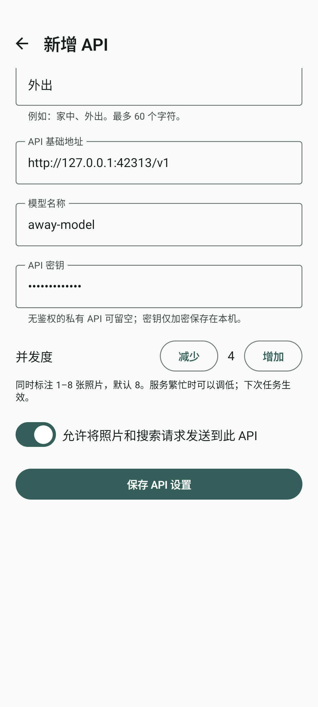
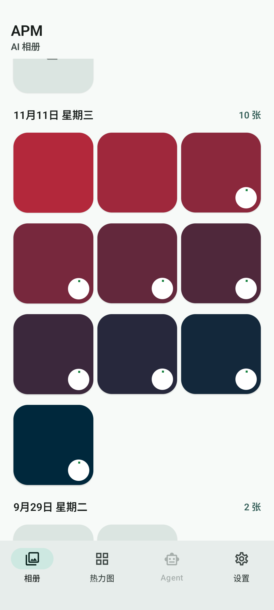

# Roadmap 0.1.0 验收记录

2026-11-11 完成。Android 为 **0.1.0（12）**，包名 `com.jinof.apm`；Python CLI 保持 0.0.5，数据库保持 schema 8。

## 实现

API 编辑页新增并发度控制，范围 1–8，默认 8。列表显示每套配置的并发度；设置与地址、模型、密钥、许可一起加密保存。旧单份、多份配置缺少字段时读取为 8，不在启动时改写旧文件。损坏的并发字段回退到 8，其他配置保留。编辑、保存、切换和旋转时各配置保持独立；测试连接期间控制项锁定，连接测试仍只发一张生成图片。

全量与所选标注共用有限工作线程。任务启动时固定 API 配置和待处理范围，最多同时处理配置数量的照片，完成一张后补充下一张。图片处理和 HTTP 请求并行，进度事件与数据库写入由单个协调线程按照片 ID 处理。单张请求失败或 JSON 不合格时保留旧标注，其余请求继续。除原有上下文超限缩图重试外，不增加自动重试。

缩略图可同时显示多个处理中圆圈。任务卡片显示并发占用、当前文件、成功／失败／跳过数量和 ETA；估算按并发量和已运行时长修正。Activity 销毁时停止调度、取消工作线程并断开在途连接；写库前检查生命周期，禁止迟到响应写入。任务仍为内存状态，不增加后台任务恢复或数据库字段。

截图使用模拟器和生成图片。配置截图中的 4 用于验证可编辑与独立保存；新配置默认值及旧配置缺省值均已验证为 8。

## 服务端上线

xspark 原有 `qwen36-35b-a3b.service` 已调整为 `max-num-seqs=8`，CUDA Graph 批次为 `[1,2,4,8]`，其余模型参数保持原值。修改前保存原单元文件并确认无运行或等待请求；重启后检查健康，实际通过 new-api 验证并发。启动或推理失败时部署脚本会恢复原配置；本次验收通过，无需回滚。

| new-api 上线验收 | 结果 |
|---|---:|
| 同时提交的图片标注 | 8 次 |
| 成功且结构校验通过 | 8/8 |
| 观测到的同时运行数 | 8 |
| 整批完整耗时 | 22.81 秒 |
| 单请求完整耗时中位数 | 21.81 秒 |
| 首字中位数 | 2.118 秒 |
| 总输出吞吐 | 243.05 token/s |
| 最低主机可用内存 | 59.61 GiB |

该请求组另有一次预热。它验证短图片请求的 8 路并发，不证明长上下文上限或长期服务 SLO。上线前单路配置与临时实例对比见 [并发基准](benchmarks/xspark-qwen-concurrency-2026-11-11/README.md)。

new-api 渠道配置和既有服务密钥哈希保持一致，临时验收令牌已删除。Gemma、IndexTTS、H3 和 Qwen3.8 的服务状态、进程与重启计数保持原值。Qwen、Gemma、IndexTTS、new-api 最终健康检查均返回 200。Qwen 的开机启用状态仍为 disabled，本次没有更改启动策略。

原配置、测量结果和前后状态在 xspark 的 `/home/jinof/benchmarks/apm-010-rollout-3ix4_w9v/`；恢复步骤见 [部署记录](xspark-qwen3.6-35b-a3b-nvfp4.md)。

## 验证结果

| 检查 | 结果 |
|---|---|
| Promise v43 | format、lint、check 通过 |
| Python | 23 项通过，功能与版本未修改 |
| JVM | 48 项通过，0 失败、0 跳过 |
| Android lint | 0 错误，7 条警告、2 条信息 |
| 模拟器 | 39 项全部通过，0 跳过，68.398 秒 |
| API-only | 主 APK 和测试 APK 均通过 |
| APK | 签名、`com.jinof.apm`、0.1.0（12）核对通过 |
| 界面 | 已查看并发编辑页、配置列表和多张处理中截图 |

JVM 覆盖 1、2、8 路的实际重叠和上限、慢请求不阻塞补充、乱序结果身份、失败隔离、取消后不再派发、并发进度与 ETA。模拟器覆盖默认值、1/8 边界、配置独立保存、旧单份与多份加密配置兼容、旋转、测试连接仍为单请求，以及历史选择、详情、查看器和热力图回归。

新增端到端用例用 10 张不同颜色的生成图片，只选其中 9 张，实际观察 8 路重叠；混入 HTTP 429 和非法 Schema，核对 7 成功、2 失败，失败照片的旧记录完整保留，未选图片没有发请求。处理中修改保存的 API 配置，剩余请求仍使用原配置。另一个用例在两路请求未返回时销毁 Activity，确认没有派发剩余照片、没有迟到写库。

首轮受限环境无法绑定 Python mock HTTP 的回环端口，切换到获准环境后通过。第一次模拟器回归的 7 项失败来自外部截图目录不可写，另有一项连接提示等待超时；该连接用例单独复核通过。改用应用内部测试输出目录，并完成代码复核与补充边界检查后，在新的隔离目录重新构建，最终完整 39 项全部通过。没有用卸载或清数据解决测试失败。

## 真机保留数据更新

已确认小米 23127PN0CC 安装 `com.jinof.apm` 0.0.9（11），私有数据库与加密配置存在。停止应用取得一致备份后，仅执行 `adb install -r`，返回 `Success`。

| 核对项 | 安装前、安装后、首次启动后 |
|---|---|
| 业务表 | 16 张表逐表内容哈希一致 |
| 历史标注 | 1579 条，完整保留 |
| 临时选择 | 均为 0，符合新会话规则 |
| 数据库 | schema 8，`quick_check=ok` |
| API 加密文件与偏好设置 | 文件哈希一致 |
| 照片等权限、首次安装时间 | 一致 |
| 已安装 APK | 与最终隔离构建及交付件 SHA-256 一致 |

冷启动命令返回 `Status: ok`，目标为 `MainActivity`。随后设备界面采样处于系统锁屏，未操作解锁或读取私人照片；具体并发界面的可视验收来自模拟器。核对后保留更新后的安装，不在真机安装测试包，不卸载、不清除应用数据、不修改照片。

真机备份与逐表比对仅保存在权限受限的本机证据目录，不提交到仓库。

## 本地交付与代码

- 唯一交付 APK：`android/APM-0.0.2-debug.apk`，内部版本 0.1.0（12），54,894,786 字节。
- SHA-256：`2cd0060b95612eb56726841698252c8d82f04917251d4e5a65bce082d0d54ff1`。
- 已测试原件：`/private/tmp/apm-010-build-3ix4_w9v-4/outputs/apk/debug/app-debug.apk`。
- 此前交付的 0.0.9 APK 保留在 `/private/tmp/apm-010-3ix4_w9v/previous-deliverable/app-debug.apk`，原哈希 `2c0dc9f57fe84c2b12627ae0435a3dcc947ca32058eb101741acd0616cc34a73`。
- 本机证据：`/private/tmp/apm-010-3ix4_w9v/`，包含构建与回归日志、签名和版本核对、模拟器截图、交付哈希、真机备份及比较结果。

实现阶段按仓库规则提交并推送 `codex/roadmap-0.1.0`，当时未创建版本标签或 GitHub Release。后续发布见 [0.1.0 发布说明](release-0.1.0.md)。此前未提交的 Gemma 部署文档及其索引改动保留在工作区，不混入本次提交。
