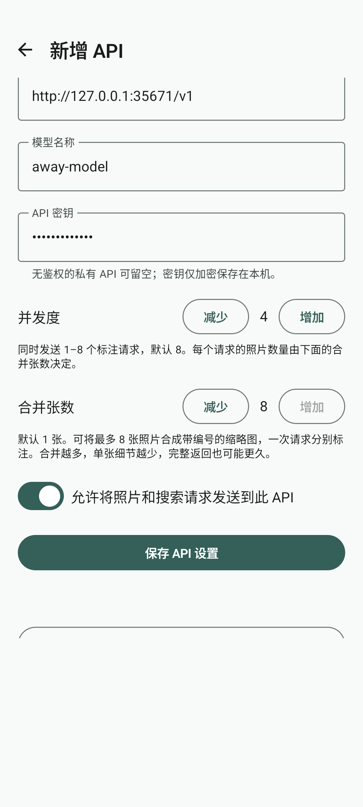
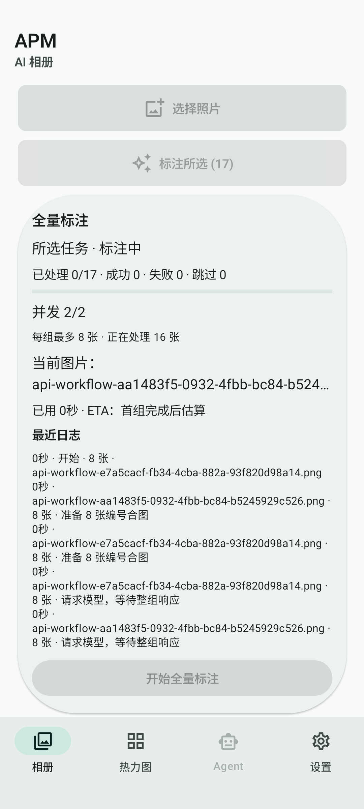
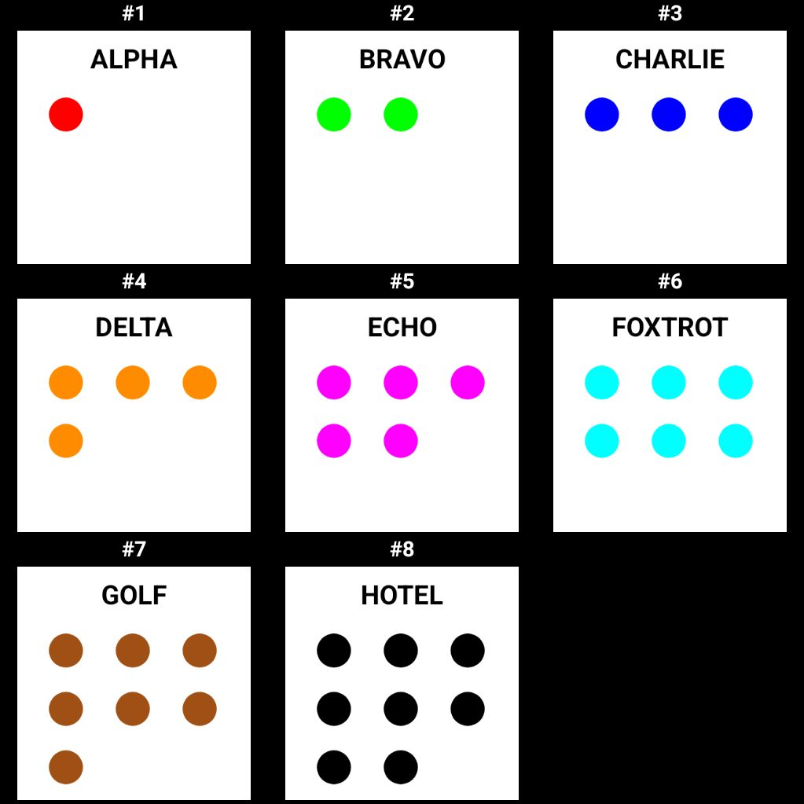

# Roadmap 0.2.0 验收记录

2026-11-11 验收。Android 为 **0.2.0（13）**，包名 `com.jinof.apm`；Python CLI 保持 0.0.5，数据库保持 schema 8。

## 实现与默认值

每个 API 新增独立的“合并张数”，范围 1–8。按用户最后的修改，**新配置和旧配置都默认 1 张**，不自动启用合图。旧加密文件读取时保持原字节，首次明确保存才写入新字段。该设置与地址、模型、密钥、并发度和许可一起保存；草稿旋转、配置切换和测试连接均使用各自的合并张数。

1 张沿用原单张请求。2–8 张将照片按原比例放入一张编号合图，最长边不超过 1024 像素；逐张按格子尺寸解码，保留边缘。原图只读，合图只留在内存。客户端使用 [Android ImageDecoder](https://developer.android.com/reference/android/graphics/ImageDecoder) 指定解码尺寸，避免依赖提供方可能已经裁切的预览图。

每次请求只发一张合图，返回的各张标注按编号关联原照片。整组校验通过后，以一个数据库事务追加标注。缺项、重复编号、非法内容或截断会使整组失败并保留旧记录，其他组继续。尾组可以不足设置值；合并设置大于 1 时，尾组只剩 1 张也沿用编号协议。没有自动拆组或单张回退；只有明确上下文超限时允许缩至 768 像素重试一次。

并发度仍为 1–8、默认 8，控制在途请求组数。并发 2、每组 8 时可同时处理 16 张，两个设置都为 8 时上限是 64 张。任务卡片分别展示请求并发、每组张数、处理中照片数和照片完成数；ETA 按请求组估算。修改配置不影响已开始的任务。相同模型的单张 v7 或合图 v1 历史标注都会跳过，调整合并张数不会强制重做。

截图中的合并数 8 是测试手动调整后的值；默认值已分别验证为 1。

## 自动化与界面验证

| 检查 | 结果 |
|---|---|
| Promise v44 | format、lint、check 通过 |
| Python | 23 项通过，功能与版本未修改 |
| JVM | 54 项通过，0 失败、0 跳过 |
| Android lint | 0 错误，7 条警告、2 条信息 |
| API-only | 主 APK、测试 APK 均通过 |
| 模拟器 | 47 项通过，0 跳过，80.213 秒 |
| APK | 包名、0.2.0（13）、调试签名核对通过 |
| 界面与像素 | 已查看合并设置、处理中任务、宽高比例及 8 格合图 |

JVM 和设备用例覆盖默认 1、1/8 边界、非法配置、独立加密保存、旧单份／多份配置不重写、草稿旋转、测试期间锁定，以及合图布局、乱序编号、缺项、重复、越界、非整数编号和末项标注无效。横向 800×100 与纵向 100×800 的生成源图，经实际 URI 解码后保留完整边缘，原文件字节一致。

端到端用 18 张不同颜色的生成图片，只选择前 17 张，合并 8、并发 2。Mock API 从收到的 JPEG 像素辨认照片，不依赖请求顺序猜测。第一组乱序返回有效结果，第二组返回重复编号，最后一组只有 1 张；结果为 **9 张成功、8 张失败**，失败组旧标注逐条保留，第 18 张没有发请求，源图字节不变。任务中修改保存的 API 配置，余下请求仍使用任务启动时的配置。

另行覆盖：两组在途时销毁 Activity，不派发尾组、不写迟到结果；一张源图不可读时整组不发 HTTP；HTTP 500 不自动重试；截断结果不写入；明确上下文超限才发送一次缩小后的合图。数据库用例在组内第二项制造外键失败，确认第一项及其索引也回滚。既有单张、选择会话、查看器、热力图和设置回归一并通过。

## xspark 真实网关验证

通过现有 new-api 调用 `qwen3.6-35b-a3b`。请求由 Android 生产合图编码器、提示词及 Schema 直接导出，仅替换测试模型名称；没有改写图片、提示词或协议。测试使用 8 张生成图片，没有上传私人照片。最终构建导出的请求和图片与实测输入逐字节一致。

| 指标 | 实测 |
|---|---|
| HTTP 请求数／图片数 | 1 次／1 张 1023×1023 JPEG，包含 8 格 |
| 请求输出上限 | 12288 token（1536 × 8） |
| HTTP／结束原因 | 200／`stop` |
| 完整响应耗时 | 24.124 秒 |
| 输入／输出 token | 1402／1570 |
| Schema 与编号 | 通过，1–8 完整且无重复 |
| OCR、圆形数量、颜色 | 各 8/8 对应正确 |

下面保留每格的实际描述、OCR、圆形结构化计数及评价。全体结果的 `daylight` 都为“室内”，但合成图没有环境线索，这一判断缺乏依据。

| 编号 | 实际返回描述 | OCR | 圆形计数 | 评价 |
|---|---|---|---:|---|
| 1 | 白色背景上有一行黑色文本和一个红色圆形。 | ALPHA | 1 | 文字、颜色、数量正确。 |
| 2 | 白色背景上有一行黑色文本和两个绿色圆形。 | BRAVO | 2 | 文字、颜色、数量及水平排列正确。 |
| 3 | 白色背景上有一行黑色文本和三个蓝色圆形。 | CHARLIE | 3 | 文字、颜色、数量及水平排列正确。 |
| 4 | 白色背景上有一行黑色文本和四个橙色圆形。 | DELTA | 4 | 核心信息正确；属性写成“2x2网格状排列”，实际为上排 3 个、下排左侧 1 个。 |
| 5 | 白色背景上有一行黑色文本和五个品红色圆形。 | ECHO | 5 | 核心信息及右下角缺位正确。 |
| 6 | 白色背景上有一行黑色文本和六个青色圆形。 | FOXTROT | 6 | 核心信息及两行三列排列正确。 |
| 7 | 白色背景上有一行黑色文本和七个棕色圆形。 | GOLF | 7 | 核心信息正确；属性写成“近似2x4网格排列(左下角缺失)”，实际是 3、3、1，左下角有圆。 |
| 8 | 白色背景上有一行黑色文本和八个黑色圆形。 | HOTEL | 8 | 核心信息及三行三列、右下角缺位正确。 |

编号和黑色框未混入 OCR，最后一个无编号空格没有产生额外照片结果。此次单次合成图测试证明该服务可接收并完整返回合图协议，**不是合图比单张更快的对照实验**，也不能代表私人图库、小字、复杂场景或 8 路长输出的质量和延迟。默认保留 1 张；合并会减少单张可用像素，且多张完整标注可能需要更长等待。

测试前后 Qwen 主进程仍为 1417613，`NRestarts=0`；Qwen 与 Gemma 的运行／等待队列均为 0，Qwen、Gemma、IndexTTS、new-api 健康检查均为 200。new-api 渠道及既有令牌的密钥、状态和权限哈希一致。只使用了限制模型、仅允许回环访问的临时验收令牌，结束后已删除；没有变更或重启服务。

## 交付与设备状态

实现验收时 ADB 只检测到测试模拟器，没有检测到真实手机，当时未执行真机安装。模拟器使用独立的只读 AVD，主包与测试包只安装到明确指定的模拟器 serial，没有在真机卸载、清数据或执行仪器测试。

唯一交付 APK 仍为 `android/APM-0.0.2-debug.apk`，内部版本 0.2.0（13）。通过最终检查后，按仓库规则从隔离构建复制到此文件名。0.1.0 原交付件先备份到本机证据目录的 `previous-deliverable/app-debug.apk`，原 SHA-256 为 `2cd0060b95612eb56726841698252c8d82f04917251d4e5a65bce082d0d54ff1`。

- 文件大小：54,928,054 字节；SHA-256：`4113e4f1db9c1b6fecbebc29550779908d1f9fe8be618059660bef14c1b90e93`。
- 最终测试原件：`/private/tmp/apm-020-build-g_kwnnih-3/outputs/apk/debug/app-debug.apk`。
- 本机证据：`/private/tmp/apm-020-g_kwnnih/`，含三次隔离构建、模拟器日志、截图、API 返回与前后状态；原件均保留。
- xspark 证据：`/home/jinof/benchmarks/apm-020-collage-g_kwnnih/`。

实现阶段按仓库规则提交并推送 `codex/roadmap-0.2.0`，当时未创建版本标签或 GitHub Release。后续发布见 [0.2.0 发布说明](release-0.2.0.md)。已有的 Gemma 部署文档及其索引改动保留在工作区，不纳入本次提交。

## 发布时真机更新复核

2026-11-11 发布时，小米 23127PN0CC 重新连接，确认安装 `com.jinof.apm` 0.1.0（12），私有数据库与加密配置存在。停止应用后仅在手机端计算文件 SHA-256，记录摘要，不导出数据库、共享偏好或配置文件内容。随后执行 `adb install -r` 更新到 0.2.0（13）。

安装前后核对结果：数据库、共享偏好、加密 API 配置和旧模型文件等 11 个私有文件逐文件哈希一致；权限、首次安装时间一致；安装后的 APK 哈希与最终验收件一致。未卸载、未清数据，也未在真机安装测试包。安装后暂未自动启动应用，因此本次比较的是升级前后的原始文件；首次启动的选择清空行为已在模拟器覆盖。

发布复核证据位于 `/private/tmp/apm-020-release-5_6loz9t/`，手机摘要位于其中的 `phone-hashes-verified/`，不包含导出的私有文件。
